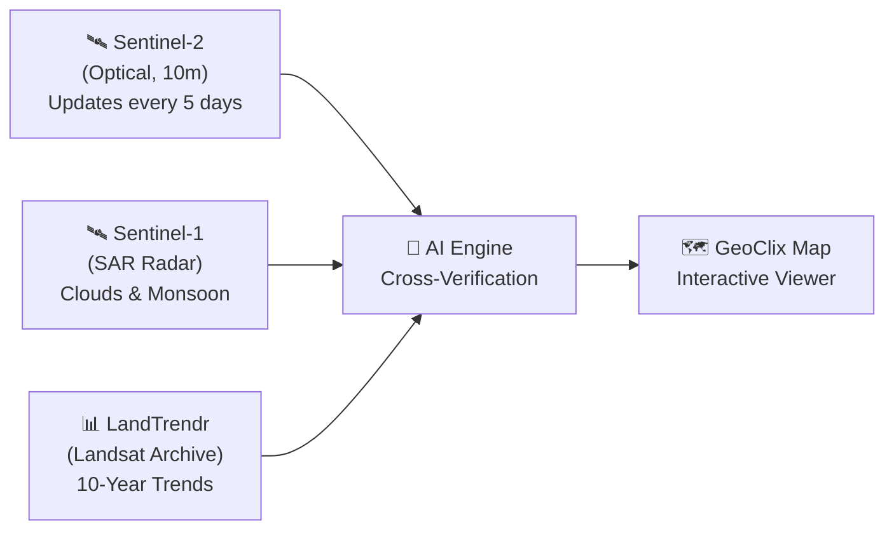
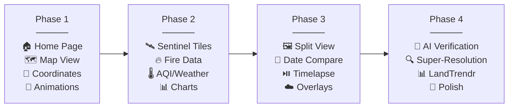

# 🌿 GeoClix — Satellite Forest Loss Alert System
*Kernel Panic - HypeNexis*

> **"Forests tell their story. We listen."**


---

## 📋 Project Overview

**GeoClix** is a static interactive prototype for exploring forest-monitoring workflows in India. It provides map, comparison, and dashboard interfaces without requiring user login or signup.

> [!WARNING]
> This repository currently contains a mixture of live public map/weather/fire requests and simulated demonstration values. It must not be used for operational forest-loss decisions until a verified data-processing and alert-validation pipeline is implemented.

> [!IMPORTANT]
> Every data source and API used in this project is **completely free**. The application requires **no authentication** from end-users. Zero cost to build, zero cost to use.

---

## 🎯 Problem Statement

Forest areas cleared for **mining, road construction, and agriculture** often go unnoticed until irreversible damage has occurred. Traditional satellite monitoring suffers from:
- **Low-resolution imagery** making small-scale deforestation hard to detect
- **Cloud cover** blocking optical sensors during monsoon seasons (June–September)
- **Seasonal false positives** — natural leaf fall misidentified as forest loss
- **Noisy labels** from single-source data leading to false alerts

---

## 🛰️ Data Sources & How They Work

### Multi-Sensor Fusion Strategy



| # | Source | Type | Role | Update Cycle | Cost |
|---|--------|------|------|-------------|------|
| 1 | **Sentinel-2** (Copernicus) | Optical (10m resolution) | Primary map imagery & NDVI change detection | Every 5 days for India | ✅ Free |
| 2 | **Sentinel-1** (Copernicus) | SAR Radar (Active Microwave) | Cloud-penetrating imagery for monsoon/cloudy days | Every 6–12 days | ✅ Free |
| 3 | **LandTrendr** (Landsat-based) | Long-term pixel trajectory analysis | Distinguish seasonal leaf-fall from actual forest loss | Historical archive (10+ years) | ✅ Free |
| 4 | **FIRMS** (NASA) | Active fire data | Real-time forest fire detection & hotspot mapping | Near real-time | ✅ Free |
| 5 | **Global Forest Watch (GFW)** | Hansen tree cover loss | Annual forest cover change baseline | Yearly | ✅ Free |
| 6 | **OpenWeatherMap** | Climate & AQI | Air quality index, temperature, humidity, weather | Real-time | ✅ Free tier |
| 7 | **OpenStreetMap / Leaflet** | Base map tiles | Interactive map rendering | Continuous | ✅ Free |
| 8 | **ERA5 (Copernicus CDS)** | Climate reanalysis | Historical climate/seasonal data (10 years) | Monthly | ✅ Free |

---

## 🧠 Built-in AI Features

### 1. Cross-Verification Engine (Noisy Label Reduction)
- Compares detections across **Sentinel-2 + Sentinel-1 + LandTrendr** — an alert is only confirmed when ≥2 sources agree
- Cross-references against **Global Forest Watch** annual data to validate
- Filters out cloud shadows, seasonal changes, and sensor artifacts

### 2. Super-Resolution Enhancement (Optional)
- AI-based upscaling of satellite imagery from 10m → ~2.5m equivalent using an **ESRGAN** model (pre-trained, runs client-side via TensorFlow.js or server-side)
- Toggled by the user via the "Enhance Resolution" button
- **Default view always shows native Sentinel-2 resolution** (no auto-enhancement)

### 3. Seasonal Intelligence
- Reads **10 years of historical climate + phenology data** to build seasonal baselines
- LandTrendr pixel trajectories separate deciduous leaf drop from clearance events
- Monsoon-period alerts automatically switch primary source from Sentinel-2 → Sentinel-1 SAR

---

## 🖥️ Application Architecture

### Tech Stack

| Layer | Technology | Reason |
|-------|-----------|--------|
| **Frontend** | HTML5, CSS3, Vanilla JavaScript | Zero dependencies, fast load, no build step |
| **Maps** | Leaflet.js + OpenStreetMap tiles | Free, open-source, lightweight |
| **Satellite Tiles** | Sentinel Hub EO Browser / Copernicus Open Access | Free Sentinel-2/1 imagery |
| **Charts** | Chart.js | Lightweight, responsive historical trend charts |
| **Animations** | GSAP (GreenSock) + CSS3 | Smooth intro animations, scroll-triggered effects |
| **Fire Data** | NASA FIRMS API | Real-time fire hotspot overlay |
| **AQI/Weather** | OpenWeatherMap API (free tier) | Real-time air quality and climate data |
| **AI (Optional)** | TensorFlow.js (client-side) | Browser-based super-resolution enhancement |
| **Hosting** | GitHub Pages / Netlify | Free static hosting, no backend needed |

> [!NOTE]
> The entire application is a **static frontend** — no backend server, no database, no login system. All data is fetched client-side from free public APIs.

---

## 📐 Interface Design — Screen-by-Screen

### Screen 1: Home Page (Hero Landing)

Matching the provided reference design:

- **Dark, cinematic hero** with aerial forest/fire imagery background
- **Navigation bar**: GeoClix logo (🌿 leaf icon) | Home · About · Maps · Insights · Our Mission | "Get Alerts" CTA button
- **Hero text**: *"SATELLITES FOR A GREENER TOMORROW"* subtitle → *"Forests tell their story. **We listen.**"* (green accent on "We listen.")
- **Sub-description**: "Real-time forest loss alerts using satellite data to protect our forests, biodiversity, and future."
- **Two CTA buttons**: `Explore Live Map →` (green pill) | `Learn More` (outlined)
- **Stats bar** (bottom): `200+ Forest Areas Monitored` | `Real-Time Loss Alerts` | `Satellite Powered — Sentinel-2`
- **Floating alert card** (top-right over imagery): "FOREST LOSS DETECTED" with coordinates, area, date
- **Satellite 3D models** floating over the forest scene
- **Warning triangle icons** (⚠️) scattered over fire/deforestation zones
- **Cool opening animation**: GSAP-powered fade-in sequence — satellite flies in, hero text types in letter-by-letter, stats count up, alert card slides in

---

### Screen 2: Interactive Overview (scrolls from Home Page)

```
┌──────────────────────────────────────────────────────────────┐
│  ┌─────────────┐  ┌──────────────────────────────────────┐   │
│  │ LEFT PANEL   │  │                                      │   │
│  │              │  │         INTERACTIVE MAP               │   │
│  │ 📍 Coords    │  │        (Full India View)              │   │
│  │ 🌡️ AQI       │  │                                      │   │
│  │ ☁️ Climate    │  │    [Click any region to explore]     │   │
│  │ 📊 Summary   │  │                                      │   │
│  │              │  │                                      │   │
│  └─────────────┘  └──────────────────────────────────────┘   │
└──────────────────────────────────────────────────────────────┘
```

- **Left panel**: Coordinates on hover, AQI widget, climate summary, environmental metrics
- **Main map**: Leaflet.js map centered on India with forest cover overlay, fire hotspots, and deforestation alert markers
- **Click interaction**: Clicking any point shows coordinates; clicking a region/POI transitions to the Detailed Analysis screen

---

### Screen 3: Detailed Location Analysis

```
┌───────────────────────────────────────────────────────────────────────┐
│  ┌──────────────┐  ┌────────────────────┬────────────────────┐       │
│  │  LEFT SIDEBAR │  │    "THEN" PANE     │    "NOW" PANE      │       │
│  │               │  │                    │                    │       │
│  │ 📍 Region Info│  │  Historical Image  │  Current Image     │       │
│  │ 🌡️ AQI        │  │  [Date Selector]   │  [Date Selector]   │       │
│  │ ☁️ Climate     │  │                    │                    │       │
│  │ 📊 Indicators │  │   ☐ Clouds (translucent)               │       │
│  │               │  │   ☐ Pollution (translucent)             │       │
│  │───────────────│  │                    │                    │       │
│  │ FOREST TREND  │  └────────────────────┴────────────────────┘       │
│  │ 📈 Graph      │                                                    │
│  │ (gain/loss    │  ┌──────────────┬──────────────┬──────────────┐    │
│  │  over years)  │  │  📍 Geo       │ 🔍 Enhance   │ ⏯️ Timelapse │    │
│  │───────────────│  │  Coordinates  │  Resolution  │  Playback   │    │
│  │ KEY EVENTS    │  │  Lat/Lng/Alt  │  [Button]    │  [Controls] │    │
│  │ 🏗️ Mining     │  └──────────────┴──────────────┴──────────────┘    │
│  │ 🌊 Floods     │                                                    │
│  │ 🔥 Fires      │    📅 FROM: [____]   TO: [____]   [Compare]       │
│  │ 💨 Pollution  │                                                    │
│  └──────────────┘                                                     │
└───────────────────────────────────────────────────────────────────────┘
```

#### A. Left Sidebar
- **Region details**: Name, state, area, elevation
- **AQI widget**: Color-coded air quality gauge
- **Climate data**: Temperature, humidity, rainfall
- **Forest cover trend graph** (Chart.js): Line chart showing forest gain (green) vs. loss (red) over 10 years
- **Key event markers**: Icons for droughts, floods, mining activity, pollution spikes with year labels

#### B. Main Visualizer — Split View
- **"Then" pane** (left): Historical satellite image with user-selectable date
- **"Now" pane** (right): Current/recent satellite image with user-selectable date
- **Draggable divider** between the two panes for swipe comparison
- **Overlay checkboxes**:
  - `☐ Clouds` — translucent white label by default, solid white when active (toggles cloud layer)
  - `☐ Pollution` — same behavior (toggles AQI/pollution heatmap overlay)
- **Date range selector**: `FROM [date picker]` → `TO [date picker]` + `Compare` button

#### C. Bottom Action Bar — Three Boxes
| Box | Title | Function |
|-----|-------|----------|
| 📍 Box 1 | **Geospatial Coordinates** | Shows Latitude, Longitude, Altitude/Elevation of selected point |
| 🔍 Box 2 | **Enhance Resolution** | Button to trigger AI super-resolution upscaling (optional feature) |
| ⏯️ Box 3 | **Historical Timelapse** | Compiles archived imagery into an animated timelapse with play/pause/speed controls |

---

## 🔥 Key Features Summary

| # | Feature | Description |
|---|---------|-------------|
| 1 | 🛰️ Sentinel-2 Optical | 10m resolution imagery, updated every 5 days |
| 2 | 🌧️ Sentinel-1 SAR | Cloud-penetrating radar for monsoon coverage |
| 3 | 📊 LandTrendr Trends | 10-year pixel trajectories to filter seasonal noise |
| 4 | 🤖 AI Cross-Verification | Multi-source confirmation to eliminate false alerts |
| 5 | 🔍 AI Super-Resolution | Optional image enhancement (default: native resolution) |
| 6 | 📅 Historical Climate | 10 years of seasonal and climate change data |
| 7 | 🔥 Forest Fire Data | Real-time NASA FIRMS fire hotspot overlay |
| 8 | 📍 Click-to-Coordinate | Click anywhere on the India map → exact lat/lng/alt |
| 9 | 🆓 100% Free | No login, no signup, no cost — all open data |
| 10 | 📆 10-Year Archive | Full decade of historical satellite and climate data |
| 11 | 🖼️ Then vs. Now Comparison | Side-by-side split view with draggable divider |
| 12 | ⏯️ Timelapse Generator | Animated playback of land transformation over time |
| 13 | 🌡️ AQI & Climate Widgets | Real-time air quality and environmental metrics |
| 14 | 🎨 Cinematic UI | GSAP animations, dark theme, smooth transitions |

---

## 📁 Project Structure

```
GeoClix/
├── index.html                  # Main entry point (all screens)
├── css/
│   ├── style.css               # Global styles, dark theme, layout
│   ├── home.css                # Hero section, animations
│   ├── map.css                 # Map view styles
│   └── analysis.css            # Detailed analysis screen styles
├── js/
│   ├── app.js                  # Main app controller & navigation
│   ├── map.js                  # Leaflet map initialization & interactions
│   ├── satellite.js            # Sentinel-2/1 tile loading & switching
│   ├── analysis.js             # Split-view, comparison, overlays
│   ├── timelapse.js            # Timelapse generator & playback
│   ├── charts.js               # Forest trend Chart.js graphs
│   ├── weather.js              # AQI & climate data fetching
│   ├── fires.js                # NASA FIRMS fire data overlay
│   ├── coordinates.js          # Click-to-coordinate handler
│   ├── ai-enhance.js           # Super-resolution enhancement (optional)
│   └── animations.js           # GSAP intro & scroll animations
├── assets/
│   ├── images/                 # Hero backgrounds, icons, logos
│   ├── icons/                  # SVG icons (satellite, fire, leaf)
│   └── fonts/                  # Custom typography
├── data/
│   └── india-forest-bounds.json # India forest region GeoJSON boundaries
├── README.md                   # This file
└── LICENSE                     # MIT License
```

---

## 🚀 How to Run

```bash
# Clone the repository
git clone https://github.com/your-username/GeoClix.git
cd GeoClix

# No build step needed — just open in browser
# Option 1: Direct file open
open index.html

# Option 2: Local server (recommended for API calls)
npx serve .
# or
python -m http.server 8000
```

Then visit `http://localhost:8000` in your browser.

> [!TIP]
> No Node.js, no npm install, no build tools required. The app runs as a pure static site.

---

## 🔑 Free API Keys Required

Some APIs need a free API key (no payment, no credit card):

| API | Free Tier | How to Get |
|-----|-----------|------------|
| OpenWeatherMap | 1,000 calls/day | [Sign up](https://openweathermap.org/api) — free forever |
| NASA FIRMS | Unlimited | [Get key](https://firms.modaps.eosdis.nasa.gov/api/area/) — instant |
| Sentinel Hub | 30,000 requests/month | [Register](https://www.sentinel-hub.com/) — free trial / research |

> [!NOTE]
> No provider secrets are stored in this repository. `config.runtime.example.js` documents the only safe browser-side setting: a public URL for a server-side API proxy. The prototype runs in labelled demo-safe fallback mode without that proxy.

---

## 🌍 Coverage & Scope

- **Geography**: All of India (pan & zoom to any location)
- **Temporal Range**: 2016–2026 (10 years of Sentinel-2/Landsat data)
- **Update Frequency**: Every 5 days (Sentinel-2 revisit for India)
- **Coordinate System**: WGS 84 (EPSG:4326) — standard GPS coordinates
- **Languages**: English (UI)

---

## ⚠️ Limitations & Disclaimers

> [!WARNING]
> - **Not a replacement for ground-truth verification.** Satellite-based alerts should be validated with on-ground inspection for official use.
> - **AI super-resolution is interpolation, not real detail.** Enhanced images look sharper but don't reveal sub-pixel features that weren't captured.
> - **Free API tiers have rate limits.** Heavy usage may hit daily caps on weather/fire APIs.
> - **Sentinel Hub free tier** has a monthly quota. For production-scale use, consider the Copernicus Data Space Ecosystem (free, unlimited for research).

---

## 📄 License

MIT License — Free to use, modify, and distribute.

---

## 🏗️ Development Roadmap



| Phase | Focus | Deliverables |
|-------|-------|-------------|
| **Phase 1** | Foundation | Home page with GSAP animations, Leaflet map, click-to-coordinate, navigation |
| **Phase 2** | Data Integration | Sentinel-2 tile layer, NASA FIRMS fire overlay, AQI/weather widgets, forest trend charts |
| **Phase 3** | Analysis Screen | Then-vs-Now split view, date pickers, timelapse player, cloud/pollution overlays |
| **Phase 4** | AI & Polish | Cross-verification logic, super-resolution toggle, LandTrendr integration, final polish |

---

**Ready to build? Review this README and confirm to proceed.** ✅
>>>>>>> d862896 (Initial commit: GeoClix satellite intelligence platform)
